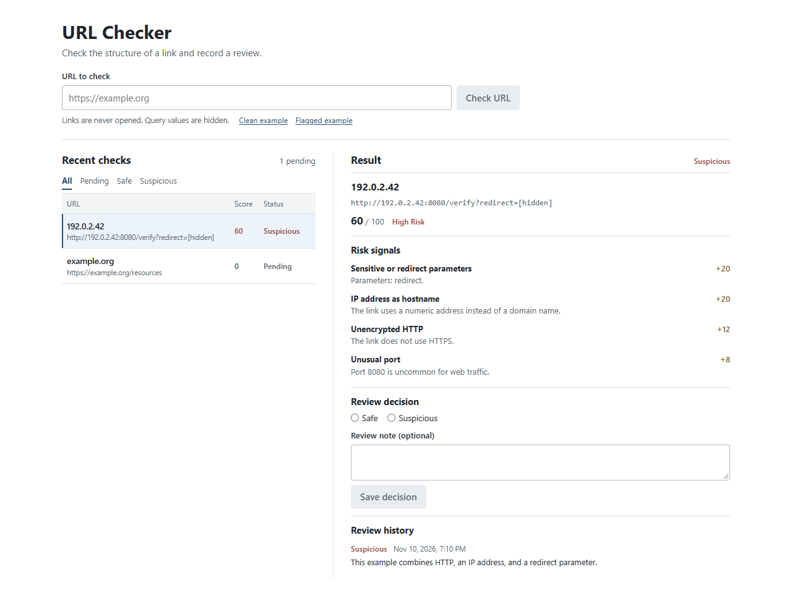

# URL Checker

A screening desk for reviewing suspicious URLs. The Node.js API analyzes the URL's structure, scores risk signals, and saves the result to PostgreSQL. In the React interface, you can inspect the findings, mark a URL safe or suspicious, and keep a history of review decisions and notes.

The score is a heuristic, not a guarantee that a link is safe. The app never opens submitted URLs. It rejects embedded credentials, hides query parameter values, and drops fragments before storing a result.



## Run locally

With Docker Compose:

```sh
docker compose up --build
```

Open [localhost:3001](http://localhost:3001). Try **Flagged example**, then **Check URL**. Record a decision and reload to see it in the review history.

For development, use Node.js 24 LTS and PostgreSQL. Start the database with `docker compose up -d db` or use a database you already have. Copy `.env.example` to `.env`, set `DATABASE_URL`, then run:

```sh
npm ci
npm run dev
```

Open [localhost:5173](http://localhost:5173). The review interface is a local demo and does not include user accounts.

## API and tests

| Method | Path | Purpose |
| --- | --- | --- |
| GET | `/api/health` | Check the database connection |
| POST | `/api/screenings` | Check and save a URL; body: `{"url":"https://example.org"}` |
| GET | `/api/screenings?status=pending` | List recent screenings, optionally filtered by status |
| GET | `/api/screenings/:id` | Get findings and review history |
| POST | `/api/screenings/:id/reviews` | Record a `safe` or `suspicious` decision and optional note |

`npm test` runs the screening rule tests. Set `TEST_DATABASE_URL` to a development or test PostgreSQL database and run `npm run test:integration` to exercise the HTTP API and persistence. The integration test creates and removes its own schema. GitHub Actions runs both suites and builds the app.

The original Python CLI is still available: `python main.py --url https://example.org`.
